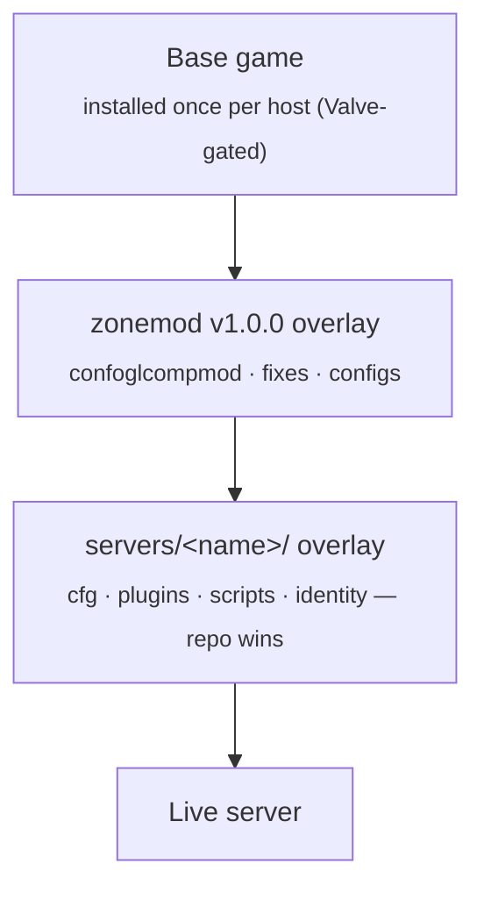
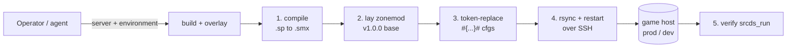

<div align="center">

# Bizzymod

**Server-side content for the Bizzymod _Left 4 Dead 2_ community servers.**

One monorepo. A self-contained overlay per game mode. Deployed by hand, on purpose.

<br/>


</div>

---

Bizzymod is a monorepo of **runtime content** for a fleet of Left 4 Dead 2 dedicated
servers. Every game mode is a **server** under [`servers/`](servers/), and every
server is **fully self-contained** — its own configs, plugins, scripts, and identity.
Nothing is shared between modes, so a change to one can never break another.

There is no application to compile in the usual sense. Working on the repo means
editing CFG / VScript / [Stripper](https://forums.alliedmods.net/showthread.php?t=39439)
files and occasionally rebuilding a SourceMod plugin from its `.sp` source. Each
server is assembled as a **stack of overlays** and shipped onto a hardened Ubuntu
game host.

> **Run your own.** [`INSTALL.md`](INSTALL.md) is a step-by-step deploy guide —
> prerequisites through a verification checklist — written to be followed by a
> person or an automation agent.

---

## The fleet

Each server is a game mode defined entirely by its directory under `servers/`.
Hostnames and matchmaking identity are applied at deploy time.

| Server | Mode | Role |
|---|---|---|
| **Bizzy's Dugout** — `servers/bizzymod/` | Realism-Versus (competitive) | The flagship. Full [`confoglcompmod`](https://github.com/SirPlease/L4D2-Competitive-Rework) matchmode — `!match` to vote among the full ruleset library. |
| **Campaign** — `servers/campaign/` | Co-op (Expert) | Hardened coop workhorse. Single pinned plugin set, 100-tick, no matchmode framework. |
| **Flat's Hole** — `servers/vanilla/` | Public Versus | Open, vanilla-feel versus on the zonemod base. |
| **Bizzy's ZoneMod** — `servers/zonemod/` | ZoneMod (latest) | Stock SirPlease zonemod plus a thin Bizzymod essentials layer. |
| **competitive** — `servers/competitive/` | — | Reserved scaffold. Nothing deploys from it yet. |

Every server runs in **two live environments**, `prod` and `dev`, that look identical
to players. See [Environments](#environments).

---

## Recent changes

A short log of notable changes for operators following the project.

- **2026-11** — Added **Bizzy's ZoneMod** (stock latest zonemod + essentials). Elevated
  the documentation set (`README`, agent-followable `INSTALL.md`) and completed a
  pre-public infrastructure pass (generic hosts, stale references removed).
- **2026-10** — Added **Flat's Hole** (public versus) and **Bizzy's Dugout**
  (competitive realism-versus). Deploy/diagnose/migrate workflows reworked to fail
  safe and report honestly when an environment is not wired.
- **2026-09** — Restructured the project into a **monorepo of self-contained
  game-mode servers**. Each mode became an independent overlay; shared plugins are
  duplicated per server by design.
- **2026-08** — Campaign brought in line with the verified-live coop configuration:
  Expert difficulty, 5–16 player scaling, smoker-pull fix (zonemod competitive
  tongue-detour plugins disabled in coop), and a hardened `bizzymod_stats` pipeline.
  Deploys made **manual-only** — no push or merge ships automatically.

---

## Architecture

Each server is built as a **stack of overlays** on top of the base game. The
SirPlease **zonemod** competitive framework is laid down first; the mode's own
Bizzymod overlay lands on top and wins every conflict.



Because servers are self-contained, **adding a mode is copy-and-adjust, never
refactor-into-shared**. Shared plugins are duplicated into each server on purpose:
isolation beats DRY when a bad config can crash a live match.

---

## Repository layout

| Path | Ships to a server? | Purpose |
|---|:--:|---|
| [`servers/<name>/`](servers/) | Yes | Per-server runtime content, rsync'd onto the host, plus a `deploy.env` manifest (not shipped). |
| [`.deploy/`](.deploy/) | No | Bootstrap, build/deploy helpers, systemd/launch units, host hardening, and the stats schema. |
| [`.github/workflows/`](.github/workflows/) | No | Deploy, diagnose, and migrate-stats workflows. |
| [`guide/`](guide/) | No | Field notes for standing up a host. |
| `CLAUDE.md` · `DEPLOY.md` · `INSTALL.md` | No | Repository documentation. |

<details>
<summary><b>Anatomy of a server</b> — what lives under <code>servers/&lt;name&gt;/</code></summary>

<br/>

| Piece | Contents |
|---|---|
| `cfg/server1.cfg` | Primary `server.cfg`, exec'd at boot: identity, gamemode, difficulty, 100-tick networking. |
| `cfg/*.cfg` | The plugin-loading source of truth (`campaign.cfg` for coop, the match chain for versus), plus the `cfgogl/<mode>/` matchmode config library. |
| `cfg/sourcemod/` | Per-plugin SourceMod cvar configs. |
| `addons/sourcemod/plugins/` | Compiled `.smx`: `optional/bizzymod/` (custom), `anticheat/` (SourceBans++ + lilac), `optional/` (loaded explicitly), `disabled/` (deploy-time quarantine). |
| `addons/sourcemod/scripting/` | `.sp` sources for the Bizzymod plugins plus vendored `bizzymod_stats/`. |
| `cfg/stripper/` | [Stripper:Source](https://forums.alliedmods.net/showthread.php?t=39439) per-map entity edits (exploit/out-of-bounds/stuck fixes, spawns, props). |
| `scripts/vscripts/` | Squirrel VScripts (can override the Director at engine level). |
| `deploy.env` | Per-server manifest: zonemod overlay on/off, matchmode quarantine, fixes to disable, SourceMod line. Not shipped. |

</details>

---

## Environments

Every server deploys to **two real, public hosts**. Players cannot tell which is which.

| | prod | dev |
|---|---|---|
| Posture | Kept spotless | Torn down and rebuilt freely |
| Access | SSH | SSH |

Per-target credentials live in a **GitHub Environment** named `<server>-<environment>`
(for example `bizzymod-prod`, `campaign-dev`). Shared database credentials are
repository-level secrets — every server reports to the same stats and SourceBans
databases. The full key list is in [`DEPLOY.md`](DEPLOY.md).

---

## Deploying

Deploys are **manual and deliberate**. No push or merge ever ships automatically.
You send a specific server to a specific environment, by hand, and the overlay is
laid onto the host over SSH.



The [`.github/workflows/`](.github/workflows/) define this as an Environment-scoped,
manual (`workflow_dispatch`) pipeline — `deploy`, `diagnose`, `migrate-stats`. The
same flow also runs by hand from the helper scripts in [`.deploy/`](.deploy/). The
full model and the secret/variable matrix are in [`DEPLOY.md`](DEPLOY.md); a
start-to-finish, follow-along deploy is in [`INSTALL.md`](INSTALL.md).

---

## Run your own

Stand up a complete, hardened Bizzymod host of your own:

```sh
# 1. Provision and harden a fresh Ubuntu 22.04 / 24.04 host (idempotent).
sudo SSH_USER=youradmin bash .deploy/bootstrap.sh

# 2. Install the base game (one-time, with a Steam account that owns L4D2).
# 3. Lay zonemod plus a servers/<name>/ overlay on top, token-replace, start.
```

[`INSTALL.md`](INSTALL.md) walks every step — prerequisites, provisioning, base-game
install, overlay and token replacement, optional stats/SourceBans databases, launch,
and a verification checklist.

---

## Conventions worth knowing

- **Campaign is coop-only.** A single mode and a single plugin set — no matchmode
  framework. Do not reintroduce one.
- **Servers are self-contained.** Never factor shared plugins into a common tree;
  each `servers/<name>/` carries its own copy.
- **Adding a plugin** means dropping the `.smx` in the right tray **and** wiring it
  up. Auto-load trays load at boot; `optional/` loads explicitly. During a
  `confoglcompmod` match, only plugins in the explicit match-chain lists survive
  `unload_all`.
- **Token placeholders** `#{TokenName}#` in cfgs are replaced at deploy time. Do not
  "fix" them to literal values.
- **SourceMod version matters.** `SOURCEMOD_VERSION` in `deploy.env` must match what
  the runtime ships, or ABI drift silently corrupts plugin behavior.
- **Line endings stay LF** (enforced by `.gitattributes`). CRLF on the host breaks
  shell scripts.

The complete conventions, for people and for automation, are in [`CLAUDE.md`](CLAUDE.md).

---

## Documentation

| Document | Read it for |
|---|---|
| [`INSTALL.md`](INSTALL.md) | Deploying your own Bizzymod host, end to end. |
| [`DEPLOY.md`](DEPLOY.md) | The deploy model, environments, and the secret/variable matrix. |
| [`CLAUDE.md`](CLAUDE.md) | Repository conventions and gotchas. |
| [`guide/`](guide/) | Field notes from standing up the live hosts. |

---

<div align="center">
<sub>Licensed under <a href="LICENSE">GPL-3.0</a> · Built for the Bizzymod Left 4 Dead 2 community.</sub>
</div>
