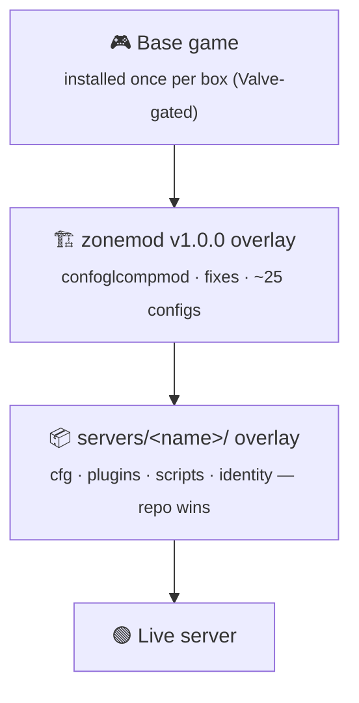
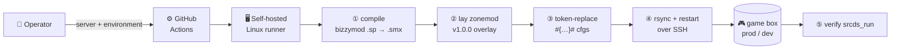

<div align="center">

# 🎯 BIZZYMOD

### Server-side content for the Bizzymod **Left 4 Dead 2** dedicated servers

*One monorepo. A self-contained overlay per game mode. One workflow to ship them all.*

<br/>


</div>

---

## What this is

A **monorepo of runtime content** for the Bizzymod L4D2 dedicated servers. Every
game mode is a **"server"** under [`servers/`](servers/), and every server is
**fully self-contained** — its own cfgs, plugins, scripts, and identity. Nothing is
shared between them, so a change in one mode can never break another.

There's no app to compile in the usual sense: *working on the repo* means editing
CFG / VScript / [Stripper](https://forums.alliedmods.net/showthread.php?t=39439)
files and occasionally rebuilding a SourceMod plugin from its `.sp` source. Build
and deploy run entirely through **GitHub Actions**.

---

## 🚀 The Fleet

Three live servers today, all on one prod box, each under its own Linux user and port.

| Server | Mode | Port | Matchmaking key | What it is |
|---|---|:--:|---|---|
| 🧟 **Bizzy's Dugout** | Realism-versus *(competitive)* | `27015` | `bizzymod` | The main event. Full `confoglcompmod` matchmode — any player can `!match` to vote among **~49 configs** (numbersmod, barrymod, bizzymod, zonemod…). |
| 🤝 **Campaign** | Co-op campaign *(Expert)* | `27016` | `bizzymod-campaign` | The hardened workhorse. Coop-only, single pinned plugin set, 100-tick. |
| 🕳️ **Flat's Hole** | Public versus | `27017` | — | Open-to-all pub versus. |
| 🏗️ *competitive* | — | — | — | Ground staked out — an empty scaffold, nobody's built on it yet. |

> Every server runs in **two live environments** — `prod` and `dev` — that look
> identical to players. See [Environments](#-environments).

---

## 🧱 Architecture

Each server is built as a **stack of overlays** on top of the base game: the
SirPlease **zonemod** competitive framework goes down first, then the mode's own
Bizzymod overlay lands on top and wins every conflict.



Because the servers are self-contained, **adding a mode is copy-and-adjust, never
refactor-into-shared.** Shared plugins are duplicated into each server on purpose.

---

## 📂 Repository layout

| Path | Ships to a server? | Purpose |
|---|:--:|---|
| [`servers/<name>/`](servers/) | ✅ | Per-server runtime content, rsync'd onto the box + a `deploy.env` manifest *(not shipped)* |
| [`.github/workflows/`](.github/workflows/) | ❌ | Every workflow — deploy, diagnose, migrate-stats |
| [`.deploy/`](.deploy/) | ❌ | Build/deploy helper scripts + server-side systemd/launch/bootstrap |
| [`guide/`](guide/) | ❌ | End-user "stand up your own L4D2 box" doc |
| `legacy/` | ❌ | Parked historical content |
| `CLAUDE.md` · `DEPLOY.md` · `README.md` | ❌ | Repo docs |

<details>
<summary><b>🔬 Anatomy of a server</b> — what lives under <code>servers/&lt;name&gt;/</code></summary>

<br/>

| Piece | What it holds |
|---|---|
| `cfg/server1.cfg` | Primary `server.cfg`, exec'd at boot. Identity, gamemode, difficulty, 100-tick networking. |
| `cfg/*.cfg` | The plugin-loading source of truth (`campaign.cfg` for coop, `bizzyload.cfg` for the match chain), plus the `cfgogl/<mode>/` matchmode config library. |
| `cfg/sourcemod/` | Per-plugin SourceMod cvar configs. |
| `addons/sourcemod/plugins/` | Compiled `.smx` — `bizzymod/` (custom), `anticheat/` (SourceBans++ + lilac), `optional/` (loaded explicitly), `disabled/` (deploy-time quarantine). |
| `addons/sourcemod/scripting/` | `.sp` sources for the Bizzymod plugins + vendored `bizzymod_stats/`. |
| `scripts/vscripts/` | Squirrel VScripts (can override the Director at engine level). |
| `deploy.env` | Per-server manifest: zonemod overlay on/off, matchmode quarantine, fixes to disable, SourceMod line. **Not shipped.** |

</details>

---

## 🌍 Environments

Every server deploys to **two real, public boxes**. Players can't tell which is which.

| | 🟢 **prod** | 🧪 **dev** |
|---|---|---|
| Host | `<PROD_HOST>` | `<DEV_HOST>` |
| SSH | port `<SSH_PORT>`, `<SSH_USER>` | port `<SSH_PORT>`, `<SSH_USER>` |
| Posture | kept spotless | torn down + rebuilt freely |

Per-target credentials live in the **GitHub Environment `<server>-<environment>`**
(e.g. `bizzymod-prod`, `campaign-dev`). Shared database creds are repo-level
secrets — every server banks at the same stats + SourceBans databases. The full
key list is in **[`DEPLOY.md`](DEPLOY.md)**.

---

## 🚢 Deploying

**Manual only.** No push, no merge ever auto-deploys — you send a specific server to
a specific environment, by hand:

```sh
gh workflow run deploy.yml -f server=bizzymod -f environment=dev
# …or the Actions tab ▸ Deploy ▸ Run workflow
```



Two sibling workflows take the same `server` / `environment` inputs:
**`diagnose.yml`** (reads the logs back to you) and **`migrate-stats.yml`** (squares
the stats database).

---

## 📏 Conventions worth knowing

- **Campaign is coop-only.** Single mode, single plugin set — no matchmode framework. Don't reintroduce one.
- **Self-contained servers.** Never factor shared plugins into a common tree; each `servers/<name>/` carries its own copy.
- **Adding a plugin** = drop the `.smx` in the right tray **and** wire it up. Auto-load trays load at boot; `optional/` loads explicitly. During a `confoglcompmod` match, only plugins in the explicit match-chain lists survive `unload_all`.
- **Token placeholders** `#{TokenName}#` in cfgs are replaced at deploy time — don't "fix" them to literals.
- **SourceMod version matters** — `SOURCEMOD_VERSION` in `deploy.env` must match what the runtime ships, or ABI drift silently corrupts plugin behavior.
- **Line endings stay LF** (`.gitattributes` enforces it) — CRLF on the box breaks shell scripts.

The complete house rules — for humans and for AI assistants — are in
**[`CLAUDE.md`](CLAUDE.md)**.

---

## 📚 Docs

| Doc | Read it for |
|---|---|
| **[`DEPLOY.md`](DEPLOY.md)** | The full deploy model, environments, and the secret/var matrix |
| **[`CLAUDE.md`](CLAUDE.md)** | Repo conventions, gotchas, and the law of the land |
| **[`guide/`](guide/)** | Standing up your own L4D2 box from bare metal |

---

<div align="center">
<sub>Licensed under <b><a href="LICENSE">GPL-3.0</a></b> · Built for the Bizzymod L4D2 community</sub>
</div>
