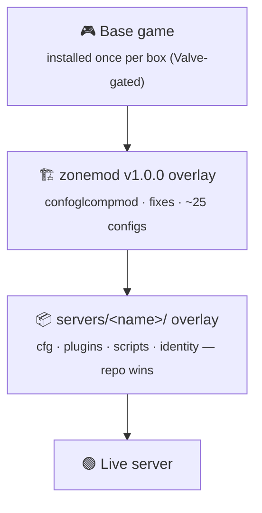
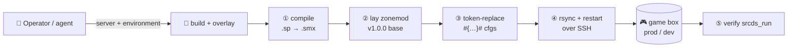

<div align="center">

# 🎯 BIZZYMOD

### Server-side content for the Bizzymod **Left 4 Dead 2** community servers

*One monorepo. A self-contained overlay per game mode. Deployed by hand, on purpose.*

<br/>


</div>

---

A **monorepo of runtime content** for the Bizzymod Left 4 Dead 2 dedicated servers.
Every game mode is a **"server"** under [`servers/`](servers/), and every server is
**fully self-contained** — its own cfgs, plugins, scripts, and identity. Nothing is
shared between modes, so a change in one can never break another.

There's no application to compile in the usual sense: *working on the repo* means
editing CFG / VScript / [Stripper](https://forums.alliedmods.net/showthread.php?t=39439)
files and occasionally rebuilding a SourceMod plugin from its `.sp` source. Each
server is assembled as a **stack of overlays** and shipped onto a hardened Ubuntu
game box.

> [!TIP]
> Want to run your own copy on your own box? Jump to **[INSTALL.md](INSTALL.md)** —
> a step-by-step deploy guide written to be followed by a human *or* an AI agent.

---

## ✨ What makes it tick

- **🗳️ 51 matchmodes, voted live.** The versus server runs the full
  [`confoglcompmod`](https://github.com/SirPlease/L4D2-Competitive-Rework) framework —
  any player can `!match` to vote among **51 rulesets** (the Bizzymod library of 24
  plus zonemod, EQ, Promod, NextMod, Acemod, Apex, Hunters…), each a complete
  `cfg/cfgogl/<mode>/` config set.
- **📊 A real stats pipeline.** A custom `bizzymod_stats` SourcePawn plugin writes
  per-round, per-player telemetry to MySQL, versioned by **15 schema migrations**
  under [`.deploy/bizzymod_stats_schema/`](.deploy/bizzymod_stats_schema/).
- **🛡️ Hardened by default.** A single idempotent
  [`bootstrap.sh`](.deploy/bootstrap.sh) turns a bare Ubuntu host into a locked-down
  game server: SSH hardening, UFW, fail2ban, GeoIP blocklists, sysctl tuning,
  unattended security upgrades, and a systemd-managed launch.
- **🧩 Overlay architecture.** zonemod goes down first; the mode's own overlay lands
  on top and wins every conflict — so each mode stays a clean, independent diff.
- **🎚️ 100-tick networking** with SourceBans++ + `lilac` anticheat across the fleet.

---

## 🚀 The fleet

Three live servers today, all on one prod box, each under its own Linux user and port.

| Server | Mode | Port | Matchmaking key | What it is |
|---|---|:--:|---|---|
| 🧟 **Bizzy's Dugout** | Realism-versus *(competitive)* | `27015` | `bizzymod` | The main event. Full `confoglcompmod` matchmode — `!match` to vote any of 51 rulesets. |
| 🤝 **Campaign** | Co-op campaign *(Expert)* | `27016` | `bizzymod-campaign` | The hardened workhorse. Coop-only, single pinned plugin set, 100-tick. |
| 🕳️ **Flat's Hole** | Public versus | `27017` | — | Open-to-all pub versus. |
| 🏗️ *competitive* | — | — | — | Ground staked out — an empty scaffold, nobody's built on it yet. |

> [!NOTE]
> Every server runs in **two live environments** — `prod` and `dev` — that look
> identical to players. See [Environments](#-environments).

---

## 🧱 Architecture

Each server is built as a **stack of overlays** on top of the base game: the
SirPlease **zonemod** competitive framework goes down first, then the mode's own
Bizzymod overlay lands on top and wins every conflict.



Because the servers are self-contained, **adding a mode is copy-and-adjust, never
refactor-into-shared.** Shared plugins are duplicated into each server on purpose —
isolation beats DRY when a bad config can crash a live match.

---

## 📂 Repository layout

| Path | Ships to a server? | Purpose |
|---|:--:|---|
| [`servers/<name>/`](servers/) | ✅ | Per-server runtime content, rsync'd onto the box + a `deploy.env` manifest *(not shipped)* |
| [`.deploy/`](.deploy/) | ❌ | Bootstrap + build/deploy helpers, systemd/launch units, server hardening, stats schema |
| [`.github/workflows/`](.github/workflows/) | ❌ | Deploy / diagnose / migrate-stats workflows |
| [`guide/`](guide/) | ❌ | Field notes for standing up a box |
| `CLAUDE.md` · `DEPLOY.md` · `INSTALL.md` | ❌ | Repo docs |

<details>
<summary><b>🔬 Anatomy of a server</b> — what lives under <code>servers/&lt;name&gt;/</code></summary>

<br/>

| Piece | What it holds |
|---|---|
| `cfg/server1.cfg` | Primary `server.cfg`, exec'd at boot. Identity, gamemode, difficulty, 100-tick networking. |
| `cfg/*.cfg` | The plugin-loading source of truth (`campaign.cfg` for coop, the match chain for versus), plus the `cfgogl/<mode>/` matchmode config library. |
| `cfg/sourcemod/` | Per-plugin SourceMod cvar configs. |
| `addons/sourcemod/plugins/` | Compiled `.smx` — `optional/bizzymod/` (custom), `anticheat/` (SourceBans++ + lilac), `optional/` (loaded explicitly), `disabled/` (deploy-time quarantine). |
| `addons/sourcemod/scripting/` | `.sp` sources for the Bizzymod plugins + vendored `bizzymod_stats/`. |
| `cfg/stripper/` | [Stripper:Source](https://forums.alliedmods.net/showthread.php?t=39439) per-map entity edits (exploit/OOB/stuck fixes, spawns, props…). |
| `scripts/vscripts/` | Squirrel VScripts (can override the Director at engine level). |
| `deploy.env` | Per-server manifest: zonemod overlay on/off, matchmode quarantine, fixes to disable, SourceMod line. **Not shipped.** |

</details>

---

## 🌍 Environments

Every server deploys to **two real, public boxes**. Players can't tell which is which.

| | 🟢 **prod** | 🧪 **dev** |
|---|---|---|
| Host | `<PROD_HOST>` | `<DEV_HOST>` |
| Access | SSH, key/password | SSH, key/password |
| Posture | kept spotless | torn down + rebuilt freely |

Per-target credentials live in the **GitHub Environment `<server>-<environment>`**
(e.g. `bizzymod-prod`, `campaign-dev`). Shared database creds are repo-level
secrets — every server banks at the same stats + SourceBans databases. The full
key list is in **[`DEPLOY.md`](DEPLOY.md)**.

---

## 🚢 Deploying

Deploys are **manual and deliberate** — no push or merge ever ships automatically.
You send a specific server to a specific environment, by hand, and the overlay is
laid onto the box over SSH:

```text
compile plugins  →  lay zonemod base  →  token-replace #{…}# cfgs
     →  rsync servers/<name>/ on top  →  restart  →  verify srcds_run
```



The [`.github/workflows/`](.github/workflows/) define this as an **automated,
Environment-scoped pipeline** (`deploy` · `diagnose` · `migrate-stats`); the
same flow also runs **by hand** from the overlay scripts in [`.deploy/`](.deploy/).
The full model and the secret/variable matrix are in **[`DEPLOY.md`](DEPLOY.md)**;
a start-to-finish, follow-along deploy is in **[`INSTALL.md`](INSTALL.md)**.

---

## 🛠️ Run your own

Stand up a complete, hardened Bizzymod box of your own:

```sh
# 1. provision + harden a fresh Ubuntu 22.04/24.04 host (idempotent)
sudo SSH_USER=youradmin bash .deploy/bootstrap.sh

# 2. install the base game (one-time, with a Steam account that owns L4D2)
# 3. lay zonemod + a servers/<name>/ overlay on top, token-replace, start
```

👉 **[INSTALL.md](INSTALL.md)** walks every step — prerequisites, provisioning,
base-game install, overlay + token replacement, optional stats/SourceBans
databases, launch, and a verification checklist — written to be executed
deterministically by a human or an AI agent.

---

## 📏 Conventions worth knowing

- **Campaign is coop-only.** Single mode, single plugin set — no matchmode framework. Don't reintroduce one.
- **Self-contained servers.** Never factor shared plugins into a common tree; each `servers/<name>/` carries its own copy.
- **Adding a plugin** = drop the `.smx` in the right tray **and** wire it up. Auto-load trays load at boot; `optional/` loads explicitly. During a `confoglcompmod` match, only plugins in the explicit match-chain lists survive `unload_all`.
- **Token placeholders** `#{TokenName}#` in cfgs are replaced at deploy time — don't "fix" them to literals.
- **SourceMod version matters** — `SOURCEMOD_VERSION` in `deploy.env` must match what the runtime ships, or ABI drift silently corrupts plugin behavior.
- **Line endings stay LF** (`.gitattributes` enforces it) — CRLF on the box breaks shell scripts.

The complete house rules — for humans and for AI assistants — are in
**[`CLAUDE.md`](CLAUDE.md)**.

---

## 📚 Documentation

| Doc | Read it for |
|---|---|
| **[`INSTALL.md`](INSTALL.md)** | Deploy your own Bizzymod, end to end (human- or agent-followable) |
| **[`DEPLOY.md`](DEPLOY.md)** | The full deploy model, environments, and the secret/variable matrix |
| **[`CLAUDE.md`](CLAUDE.md)** | Repo conventions, gotchas, and the law of the land |
| **[`guide/`](guide/)** | Field notes from standing up the live boxes |

---

<div align="center">
<sub>Licensed under <b><a href="LICENSE">GPL-3.0</a></b> · Built for the Bizzymod L4D2 community</sub>
</div>
